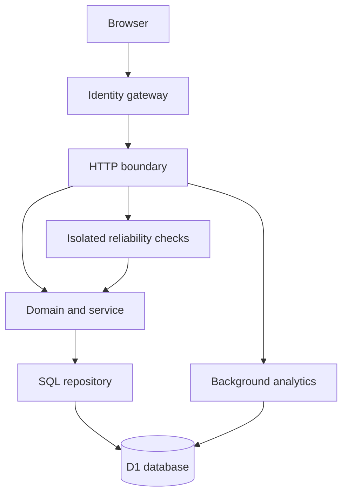

# Architecture and guarantees

## Scope

A modular monolith on the Fetch API, with a React interface and one relational D1 database. TypeScript is strict with unchecked array access enabled. Business code depends on a small database contract instead of framework request globals. Tests run the same statements against real SQLite. Cloudflare-specific bindings are confined to the Worker boundary.

## Request flow

1. Dispatch enforces private workspace access and inserts authenticated identity.
2. The Worker routes API/redirect requests before the page framework.
3. Management calls require identity. Mutations require an exact same-origin `Origin`; cross-site Fetch Metadata is rejected. General and operation-specific counters impose per-identity fixed-minute limits.
4. The HTTP boundary validates content type, streaming body size (8 KiB), supported fields and types. Parameters are bound into SQL.
5. The service handles retries, collisions and lifecycle transitions. Database uniqueness and atomic batches own correctness under races.
6. Replies use precise status codes and structured problem bodies. Logs contain generated request IDs, route classes, methods, status and duration, never submitted URLs or identity values.

## Atomicity and concurrency

`links.alias` has a unique index. `(ownerId, creationKey)` has a unique index. The insert uses `ON CONFLICT DO NOTHING RETURNING *`; the service distinguishes a key replay from an alias conflict after the database decision. Generated aliases retry at most five times.

An insert and its audit event share one D1 batch transaction. The audit is inserted only if the new resource ID exists, preventing events for rejected inserts. Revocation uses a version predicate; its deterministic audit ID prevents duplicate revocation events. D1 batch rollback is documented by Cloudflare; the SQLite adapter exercises SQL transaction rollback with an intentionally failing trigger.

List pagination orders by `(createdAt DESC, id DESC)`, with both values in a validated cursor. An immutable ID breaks timestamp ties. Cursor values are not authorization: every query still filters by authenticated owner.

## Data model

- `links`: immutable destination/alias, owner, creation timestamp, idempotency key/hash, nullable expiry/revocation, integer version.
- `audit`: resource reference, owner, action, timestamp. Atomic with mutation; not cryptographically tamper-evident against database administrators.
- `daily_metrics`: one counter per `(linkId, UTC day)`; atomic increment.
- `rate_limits`: one counter per operation/identity, with a minute number. No IP-based tracking.

Schema migrations are generated and checked in. Migration 0001 only appends nullable lifecycle fields and a constant version default. Migration 0000 is retained unchanged. Production requests do not create or alter tables.

## Decisions

| Decision                          | Reason                                                      | Cost                                                                        |
| --------------------------------- | ----------------------------------------------------------- | --------------------------------------------------------------------------- |
| Single service / relational store | Small, reviewable consistency boundary                      | A hot link or write-heavy workload can bottleneck the database              |
| 302 + no-store                    | Expiration/revocation must be consulted on resolution       | A database read for every redirect                                          |
| Background best-effort analytics  | Redirect response is independent of counter success         | Undercount after failed or terminated writes                                |
| No destination fetching           | No metadata-fetch SSRF surface or crawler complexity        | Titles are entered by users or default to the hostname                      |
| Permanent alias reservation       | Old links cannot later point to an unrelated owner's target | Records and keys need lifecycle governance                                  |
| Trusted platform identity         | Avoid building a second credential/session system           | Deployment must preserve the gateway boundary                               |
| Fixed-minute rate limiter         | Atomic, durable and easy to inspect                         | Up to two windows of traffic can arrive near a boundary; not a DDoS defense |

## Boundaries and scale

No global cache or read-replica session is used for link resolution; do not add a stale cache without a revocation consistency design. A redirect racing a committed revocation may have been authorized by an earlier read. The service does not promise that in-flight responses can be recalled.

Cloud capacity is not measured by local tests. Before an external/public rollout, run representative distributed load tests, provision edge rate limiting, establish database limits and observability, verify the identity gateway, and rehearse restore. Splitting the service or adding a durable event queue should be justified by measurements.

References consulted for behavior, not implementation copying:

- https://developers.cloudflare.com/d1/worker-api/d1-database/
- https://developers.cloudflare.com/d1/worker-api/prepared-statements/
- https://cheatsheetseries.owasp.org/cheatsheets/REST_Security_Cheat_Sheet.html
